# IAM Lifecycle & RBAC Platform

A mini enterprise identity and access management (IAM) application written in plain Java 17, JDBC and MySQL, with no framework. It manages employees through the **joiner / mover / leaver** lifecycle, assigns access from business rules, detects **separation-of-duties (SoD)** conflicts and **excessive access**, and keeps an **append-only audit trail**.

It is the same set of problems an identity governance product such as SailPoint IdentityIQ solves, built by hand so every rule is visible in the code. The employee data comes from the same HR source that feeds my IdentityIQ lab, so both systems share one source of truth.

> **Status:** v1 (console app, tests, CSV report) and v2 (REST API on Tomcat, Postman collection) are complete. v3 (HTML/JS dashboard) is next.

## Features

- **Rule-driven role assignment.** Department and job title map to roles through a `role_rules` table. Changing a rule needs no code change.
- **Joiner / Mover / Leaver workflows.** Each runs in a single JDBC transaction. Any failure rolls the whole workflow back.
- **SoD enforcement.** Every grant is checked, and a conflicting grant is refused and audited. A full scan finds violations that already exist.
- **Excessive-access detection.** Finds direct (out-of-role) grants and terminated employees who still hold access.
- **Append-only audit log.** Database triggers block `UPDATE` and `DELETE` on `audit_log`.
- **"Who has access to what" CSV report** for reviewers and auditors.
- **REST API** on Tomcat 9 (port 8081) with a Postman collection that runs the whole lifecycle.
- **JUnit 5 tests** against a separate test database, including a transaction rollback test and every API endpoint.

## Tech stack

Java 17 (records, enums) · Maven · JDBC with `PreparedStatement` only · MySQL (XAMPP) · JUnit 5 · DAO pattern · Servlet 4 on Tomcat 9 (no framework, no JSON library).

## Lifecycle rules

| # | Rule | Behaviour |
|---|------|-----------|
| 1 | **Role assignment** | Department + job title map to roles through `role_rules`. A rule with no job title applies to everyone in that department. Example: Engineering + Backend Engineer gives `ENG_BASE` and `ENG_DEVELOPER`. Roles are cumulative. |
| 2 | **Joiner** | Insert the employee, assign roles from the rules, grant the role entitlements (`source = ROLE`), write audit entries. |
| 3 | **Mover** | Compute roles for the new department and title, revoke roles no longer mapped, grant the new ones, update the employee, audit each change. `DIRECT` entitlements are **not** silently removed; the excessive-access scan flags them instead. |
| 4 | **Leaver** | Revoke every role and entitlement (both `ROLE` and `DIRECT`), set `status = TERMINATED` and `exited_on`. The employee row is never deleted. |
| 5 | **SoD conflict** | An employee must not hold both entitlements of a pair in `sod_rules`. Checked on every grant (the grant is blocked and a `SOD_BLOCKED` entry is audited) and in a full scan. |
| 6 | **Excessive access** | An entitlement held as `DIRECT`, or one not granted by any of the employee's current roles. |
| 7 | **Terminated with access** | Any `TERMINATED` employee who still holds roles or entitlements. |
| 8 | **Atomicity** | Each JML workflow runs in one transaction. A failure part-way leaves no partial state. |
| 9 | **Audit** | Every grant, revoke and lifecycle event is written to `audit_log`, which is append-only. |

The full role table is in [`docs/RULES.md`](docs/RULES.md).

### SoD pairs

| Entitlement A | Entitlement B | Reason |
|---|---|---|
| `CREATE_VENDOR` | `APPROVE_PAYMENT` | Creating a vendor and approving its payments must be separate people. |
| `DEVELOPER_PROD_WRITE` | `PROD_DEPLOY_APPROVER` | Writing to production and approving the deployment must be separate people. |

### Seeded problems (used by the detection tests)

The seed data deliberately contains access problems so the detectors have something to find.

| Employee | Problem | Detected as |
|---|---|---|
| S106 (TERMINATED) | Still holds role-based access | terminated with access |
| S304 (TERMINATED) | Leftover `DIRECT` `ESCALATION_QUEUE` | terminated with access + direct access |
| S402 Kavya Rajan | `CREATE_VENDOR` via role plus `APPROVE_PAYMENT` granted directly | SoD violation + direct access |
| S103 Lavanya Krishnan | `DEVELOPER_PROD_WRITE` via role plus `PROD_DEPLOY_APPROVER` granted directly | SoD violation + direct access |
| S305 Zoya Ansari | `CI_PIPELINE_ADMIN` granted directly | direct access only |

## Schema

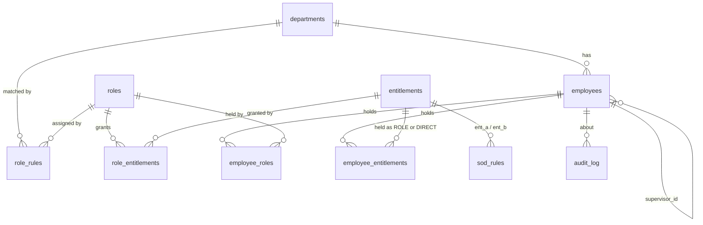

| Table | Purpose |
|---|---|
| `departments`, `employees` | Employees with department, job title, supervisor and status (`ACTIVE`, `ON_LEAVE`, `TERMINATED`). |
| `roles`, `entitlements`, `role_entitlements` | Roles, the entitlements they grant, and the application each entitlement belongs to. |
| `role_rules` | Business rules: department (+ optional job title) to role. |
| `employee_roles` | Roles an employee currently holds. |
| `employee_entitlements` | Entitlements an employee holds, with `source` = `ROLE` or `DIRECT`. |
| `sod_rules` | Pairs of entitlements that must not be held together. |
| `audit_log` | Append-only trail, protected by `BEFORE UPDATE` / `BEFORE DELETE` triggers. |

## Setup

1. Install Java 17 and Maven. Start MySQL (for example from XAMPP).
2. Make sure the HR source database `corp_hr_directory` with table `staff_records` exists on the same MySQL server. `seed.sql` copies the 20 sample employees from it.
3. In phpMyAdmin, open the **Import** tab and import `sql/schema.sql`, then `sql/seed.sql`. Run them in that order. `schema.sql` drops and recreates `iam_platform`.
4. Copy `config.properties.example` to `config.properties` and set your MySQL user and password.
5. Run the console app:
   ```
   mvn compile exec:java
   ```
   or run `com.iam.cli.Main` from your IDE.

### Running the tests

1. Create an empty database named `iam_platform_test`.
2. Copy `config.test.properties.example` to `config.test.properties`.
3. Run:
   ```
   mvn test
   ```

The tests drop and rebuild the test database from `schema.sql` and `seed.sql` before each test, and refuse to run against any database whose name does not end in `_test`, so your real data is never touched.

## Demo

Run `com.iam.cli.Main`. The menu:

```
 1  List employees
 2  View one employee's access
 3  Joiner   (hire)
 4  Mover    (department / title change)
 5  Leaver   (terminate)
 6  Grant a DIRECT entitlement (SoD-checked)
 7  Revoke a DIRECT entitlement
 8  Scan: SoD violations
 9  Scan: excessive access and terminated-with-access
10  Export "who has access to what" (CSV)
11  Audit log
 0  Exit
```

### SoD scan

The scan finds the two seeded violations, S103 and S402.

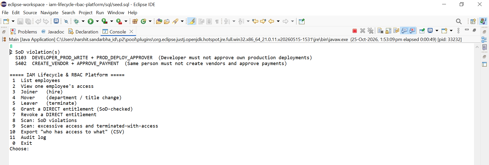

### Excessive access and terminated-with-access

Six findings: four direct grants, plus two terminated employees who still hold access.

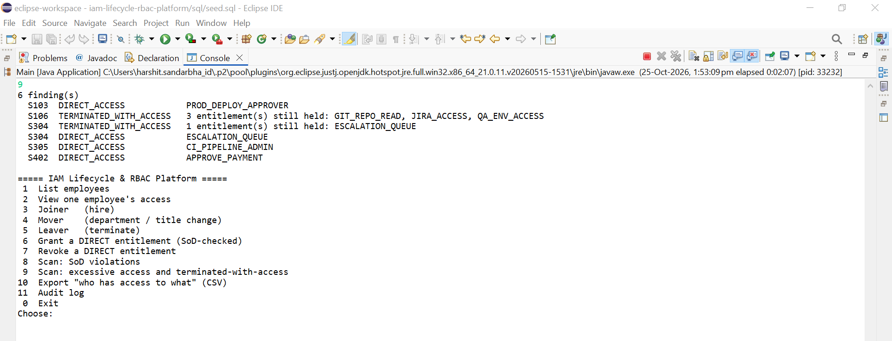

### Leaver

Terminating S105 revokes every role and entitlement. The employee row stays, marked `TERMINATED`.

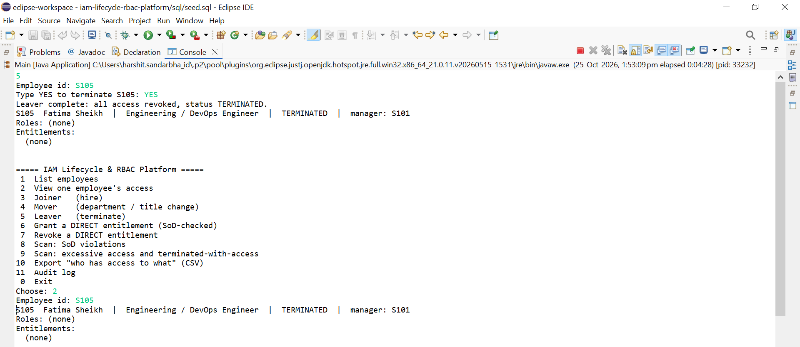

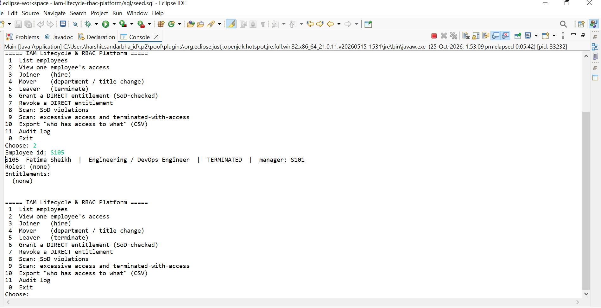

### SoD block

Granting `CREATE_VENDOR` to S403 works. Granting `APPROVE_PAYMENT` as well is refused, nothing is written, and a `SOD_BLOCKED` entry goes to the audit log.

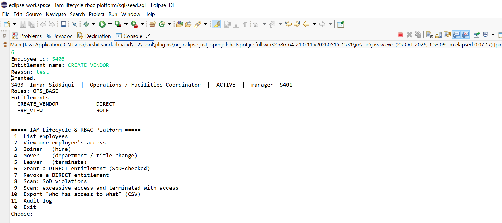

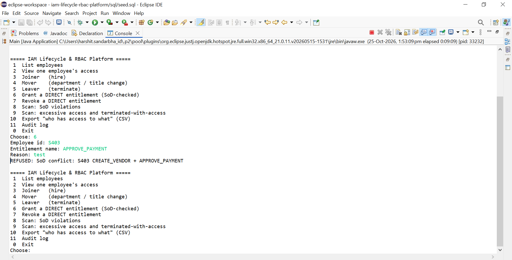

### Audit trail

Each revoke and the `LEAVER` event is recorded with who, when and why.

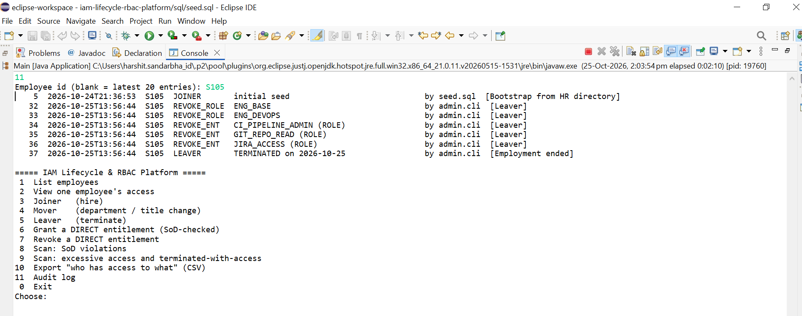

### Tests

10 core tests pass: joiner, mover, leaver, unknown employee, SoD block, mid-workflow rollback, both detectors, revoke-clears-finding, and the CSV report. The v2 API adds a further 13 (JSON handling and every endpoint). The screenshot below was taken before they were added.

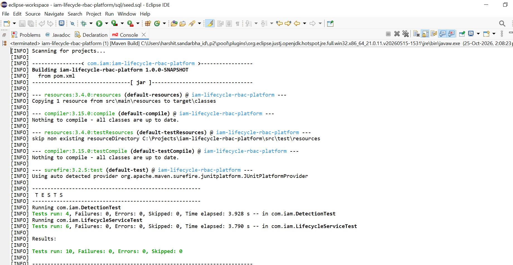

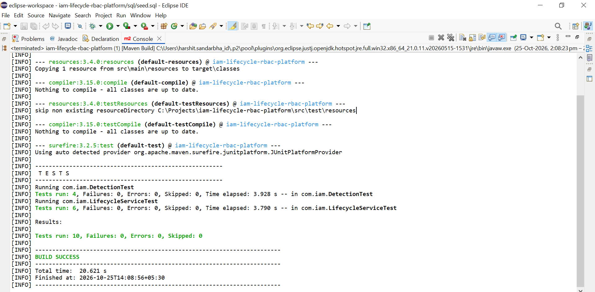

## REST API (v2)

The same services behind the console menu are exposed over HTTP. The API is a single servlet that hands every request to a plain Java router (`ApiRouter`), so each endpoint is also tested without a web server.

| Method | Path | Purpose |
|---|---|---|
| POST | `/employees` | Joiner |
| POST | `/employees/{id}/move` | Mover |
| POST | `/employees/{id}/leave` | Leaver |
| POST / DELETE | `/employees/{id}/entitlements[/{name}]` | Grant or revoke a DIRECT entitlement (SoD-checked, `409` on conflict) |
| GET | `/employees`, `/employees/{id}` | Read employees with roles and entitlements |
| GET | `/reports/access`, `/reports/sod`, `/reports/excessive` | Reports and scans |
| GET | `/audit` | Audit trail |

Full request and response examples are in [`docs/API.md`](docs/API.md).

### Run it on Tomcat 9 (port 8081)

The scripts in `deploy/tomcat/` create a second, separate Tomcat instance, so it can run next to any other Tomcat on the machine. Edit the paths at the top of each script first.

1. Run `setup-iam-api-tomcat.bat` once.
2. Build the WAR: `mvn clean package -DskipTests` (it produces `target/iam-api.war`).
3. Run `deploy-war.bat`, then `start-iam-api.bat`.
4. Open <http://localhost:8081/iam-api/api/health>.

Tomcat must run on **Java 17**, because the code is compiled for it. `start-iam-api.bat` uses `JAVA_HOME` if it points to a JDK, and otherwise looks for a Temurin 17 under `C:\Program Files\Eclipse Adoptium`.

`start-iam-api.bat` passes `-Diam.config=...\config.properties`, so the API uses the same database settings as the console app.

### Postman

Import `postman/iam-api.postman_collection.json` and run the collection. It hires a new employee, moves them, tries a conflicting grant (blocked with `409`), terminates them, and reads the reports and the audit trail. Every request has tests, and each run uses a fresh employee id, so it can be run repeatedly.

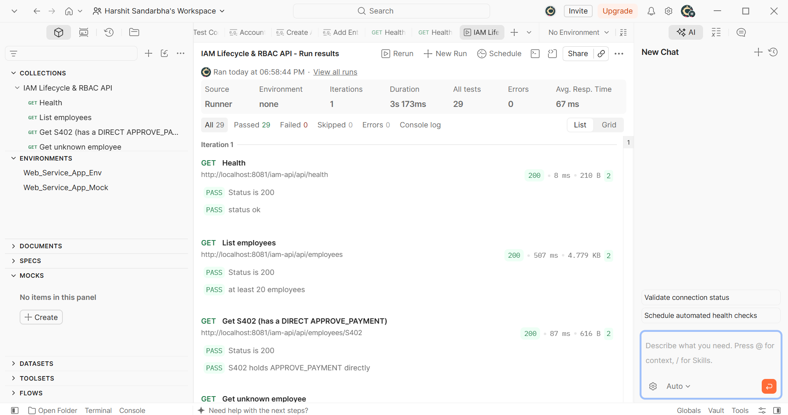

The conflicting grant is rejected with `409` and the violation is reported, while the allowed grant returns `201`:

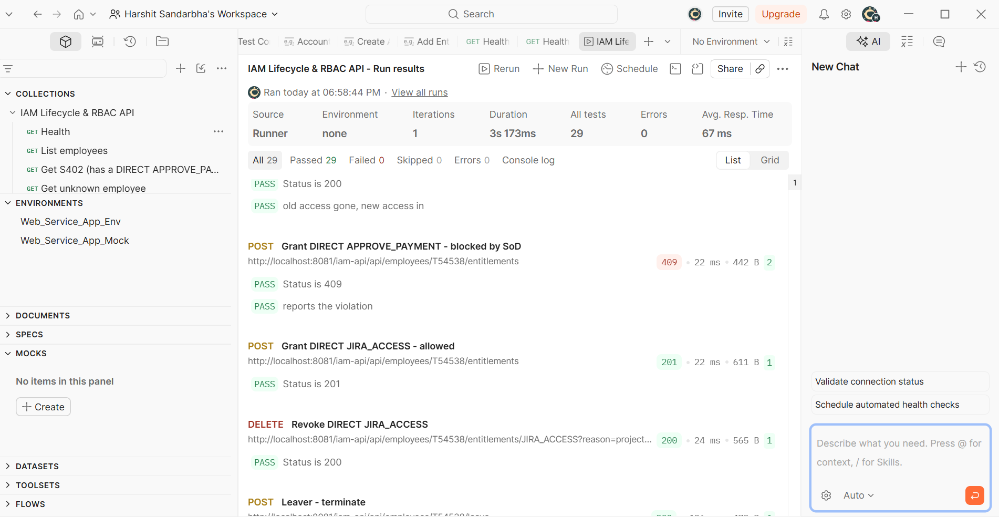

## Project layout

```
src/main/java/com/iam/
  model/      Employee, Role, Entitlement, EmployeeEntitlement, AuditEntry,
              SodRule, SodViolation, AccessFinding, enums Status, Source, FindingType
  dao/        DAO interfaces and JDBC implementations (every method takes a Connection)
  rules/      RoleAssignmentRule, DepartmentBaseRule, JobTitleRule, RulesEngine
  service/    LifecycleService (joiner, mover, leaver), SodChecker,
              ExcessiveAccessFinder, ReportService
  exception/  EmployeeNotFoundException, SoDViolationException
  util/       DbConnection, ConnectionFactory
  cli/        AppContext (wiring), Main (menu)
  api/        ApiServlet (web adapter), ApiRouter (all endpoints), Json, ApiResponse
src/main/webapp/          landing page (the v3 dashboard will live here)
src/test/java/com/iam/    TestDb, LifecycleServiceTest, DetectionTest, ApiRouterTest, JsonTest
sql/                      schema.sql, seed.sql
deploy/tomcat/            scripts for the second Tomcat on port 8081
postman/                  Postman collection
docs/                     RULES.md, API.md
```

Design notes:

- DAO methods take a `Connection`, so a service can run several DAO calls inside one transaction.
- Blocked SoD attempts are audited in a separate transaction after the main one rolls back, so the refusal is recorded even though the grant is not.
- Role rules live in the database, not in code. The rules engine reads them, so adding a rule is an `INSERT`.

## How this maps to SailPoint IdentityIQ

| This project | IdentityIQ equivalent |
|---|---|
| `corp_hr_directory.staff_records` | Authoritative JDBC application (HR source) |
| `employees` table | Identity cube |
| `supervisor_id` | Manager correlation |
| `role_rules` | Birthright roles / role assignment rules |
| `roles`, `role_entitlements` | Business and IT roles with entitlements |
| `employee_entitlements.source = DIRECT` | Additional access outside any role |
| `sod_rules` | SoD policies and policy violations |
| Excessive-access finder | Access review / certification candidates |
| JML services | Lifecycle events and the Joiner / Mover / Leaver workflows |
| `audit_log` | Audit events and identity history |

## Roadmap

- [x] Schema, seed data, rules documented
- [x] Model and DAO layer
- [x] Rules engine
- [x] JML services with transactions
- [x] SoD and excessive-access detection
- [x] CLI and CSV access report
- [x] JUnit tests
- [x] v2: servlet API on Tomcat 9 (port 8081) with a Postman collection
- [ ] v3: HTML/JS dashboard
